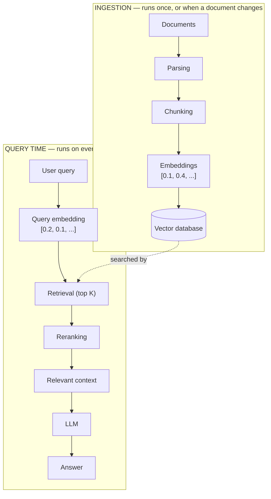
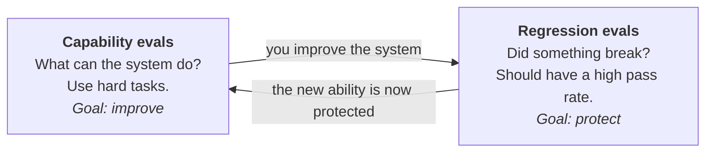
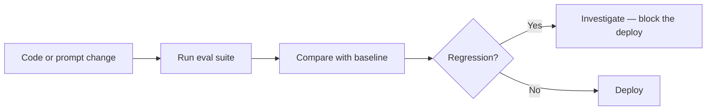
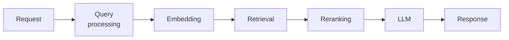
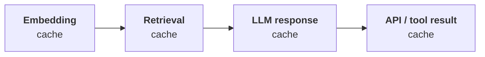
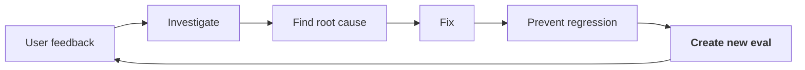
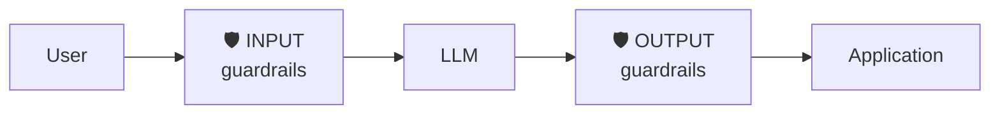
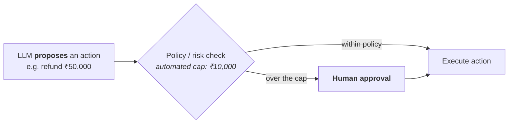
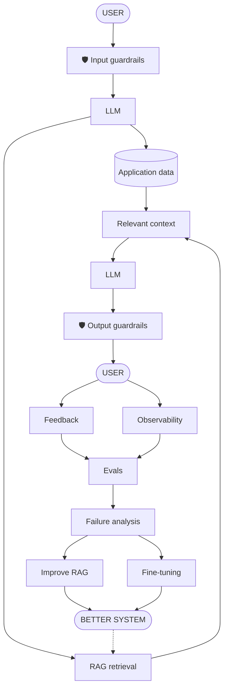
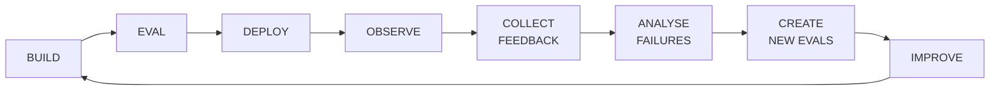

# The 7 parts of a production AI system

**Source:** ["Production GenAI Systems" — Google Doc](https://docs.google.com/document/d/12FBU-Ss2Ugo9YCyKXREy9_x5Pudxi8rE4FpuZ91R6Jk/mobilebasic) (no author stated).
This note covers the same ideas in our own words and maps each one onto our code. See [the folder rule](README.md) for why it is not a copy.

> **Diagrams.** The flowcharts below are written in Mermaid. They render automatically on GitHub.
> In VS Code they need the free extension **"Markdown Preview Mermaid Support"** — until you install it you will see the code instead of the picture.
> The original hand-drawn versions are saved on your machine at `notes/reference/private/genai-diagrams/`, which is gitignored and never uploaded.

---

## Why this note matters

Our other notes teach you to **build** a RAG app and an agent. This one teaches you what is still missing when the demo works.

The gap looks like this:

```
A demo:        Prompt  ->  LLM  ->  Answer

A real system: Prompt -> Guardrails -> Retrieval -> LLM -> Guardrails -> Answer
                                                                          |
                              Evals <- Observability <- Feedback <--------+
```

Most people stop at the demo. The seven parts below are what the next six months look like, and they are what a senior interviewer asks about.

---

# Part 1 — RAG: giving the model the right knowledge

You know this one. [Note 3](../03-rag.md) and [simple words, Part 3](../ai-in-simple-words.md) cover it.

**Goal: give the model the right knowledge at the moment it answers.**

There are two pipelines, and it helps a lot to see them as separate things. One runs rarely. One runs on every question.



**Key points**

- Good retrieval = good context = good answer. The chain starts at retrieval.
- The knobs are: chunk size, overlap, metadata, embeddings.
- Hybrid search plus reranking improves quality.
- Keep documents updated, or you serve stale context with full confidence.

### The six ideas, and where ours live

| Idea | What it means | In our code |
| --- | --- | --- |
| Chunking | How you cut documents, and what size | `Chunking.cs` |
| Embeddings | Meaning turned into numbers | `Embeddings.cs` |
| Vector database | Storing and searching those numbers | `VectorIndex` in `Search.cs` |
| Hybrid search | Keyword **and** meaning together | `HybridSearch` in `Search.cs` |
| **Reranking** | A second, slower pass that re-orders the top results | **We do not have this** |
| **Metadata filtering** | Only search documents for this customer, this product, this version | **We do not have this** |

The last two are real gaps in our project, and you should be able to name them.

**Reranking** matters because the first search is fast and rough. A reranker takes the top 20 and re-scores them properly. Remember Day 2, where `incidents.md` appeared as passage 3 and answered nothing? That is exactly what a reranker removes.

**Metadata filtering** matters more, and it is a safety issue, not a quality issue. If your assistant serves many customers, you must filter to one customer's documents **before** the search runs, not after the model has seen them. Putting another customer's text in the prompt is a data leak even if the answer does not mention it.

### The six ways RAG fails

Learn this list. It is a very common interview question.

1. The correct document was **not retrieved** — nothing downstream can save you
2. The wrong document was ranked **first**
3. The documents are **stale** — search confidently returns last year's policy
4. **Poor chunking** — the fact was cut away from the sentence that qualifies it
5. **Too much context** — the right passage is buried among irrelevant ones
6. **Hallucination despite correct context** — the passage was right there and the model still invented something

You have personally seen 6 happen. On Day 5, the model read `failover.md`, which says *"do not fail over while a provision lock is held"*, and wrote *"a provision lock is in place."* Correct document, correct retrieval, wrong sentence.

> **The key sentence:** RAG is a knowledge problem, not a model-training problem.

---

# Part 2 — Fine-tuning: teaching the model how to behave

This is the one thing in this note our project does **not** do at all, so read it carefully — you will be asked to compare it with RAG.

**Fine-tuning** means taking a trained model and training it further on your own examples. It changes the model's **weights** — the numbers inside it.

Compare that with everything we have done: we never changed any weights. We only changed what we put in the prompt.

### RAG or fine-tuning?

**Goal: teach the model how to behave — not what to know.**

Use it for: a consistent output format, a specific style or tone, classification and extraction, or domain-specific behaviour.

| Aspect | RAG | Fine-tuning |
| --- | --- | --- |
| What it changes | The **context** / knowledge | The **model's behaviour** |
| Knowledge freshness | Easy — just update the documents | Hard — retrain |
| Private / internal knowledge | Good | Expensive to maintain |
| Style / format | Limited | Strong |
| Classification | Possible | Often useful |
| Cost (long term) | Lower | Higher |

### The rule

> **Use RAG for knowledge. Use fine-tuning for behaviour.**

- "Answer from our runbooks" → **RAG**. The runbooks change weekly.
- "Always reply in our support tone, in this exact JSON shape" → **fine-tuning** may help.

### The most common mistake

Fine-tuning a model so it "knows" information that changes often.

You pay to train, and the day a runbook is edited your model is wrong again, with no way to tell. RAG handles that by editing a text file.

**LoRA / PEFT** are worth knowing by name. They mean "parameter-efficient fine-tuning" — instead of retraining the whole model, you train a small extra piece. Much cheaper. If someone says LoRA, they mean cheap fine-tuning.

---

# Part 3 — Evals: how you test something that is not deterministic

The deepest topic here, and the one that separates engineers from demo-builders.

**The problem:** normal code is deterministic. `Add(2,2)` is always `4`, so `Assert.Equal(4, ...)` works forever. A model can answer the same question differently twice. You cannot assert on the exact words.

### The vocabulary

Learn these five words. This is standard terminology and using it correctly signals experience.

| Word | Meaning | In our project |
| --- | --- | --- |
| **Task** | One test case: an input and what success means | One entry in `content/eval/questions.json` |
| **Trial** | One run of that task | One call to `SearchAsync` |
| **Transcript** | A record of what happened during the run | Our console output; the `AgentStep` list |
| **Grader** | How you decide if it passed | "Is the expected file in the top 3?" |
| **Outcome** | What actually ended up happening | `Pass` / `Fail` in `EvalCaseResult` |

Two more:

- **Evaluation harness** — the machinery that runs tasks, captures transcripts, applies graders. Ours is `RetrievalEval` in `Evaluation.cs`.
- **Evaluation suite** — a set of tasks testing one capability. Ours is the 8 questions in `questions.json`.

### Three kinds of grader

**1. Code-based.** Deterministic checks. Exact match, regex, schema validation, a database row, an API result.
→ Fast, cheap, repeatable. Too rigid for anything subjective.
→ **Ours is this.** `RetrievalEval` is a code grader. That is why it runs in 100 milliseconds and never disagrees with itself.

**2. Model-based** ("LLM as a judge"). You ask another model to grade the answer, using a rubric or a comparison.
→ Flexible, handles subjective quality. But it can be inconsistent and biased, and now you have two models to trust.
→ `AnswerRubric` in `Evaluation.cs` is a crude, code-based step toward this.

**3. Human.** Expert judgement.
→ The best quality, and the only way to validate your model-based graders. Expensive, slow, does not scale.

They are not rivals. Use code graders where you can, model graders where you must, and humans to check that the model graders are sane.

### Capability evals vs regression evals

Two different jobs, and you need both:



- **Capability** — "what can it do?" Use **hard** tasks, where there is room to improve. A low score here is useful information.
- **Regression** — "did I break something that worked?" These should pass at a very high rate. A failure here is an alarm.

Our 8 questions are a **regression** suite. They all pass, and if a change breaks one, the build fails. We have no capability suite — no deliberately hard questions. That is a gap you can name.

### Non-determinism: `pass@k` and `pass^k`

This is a sharp idea and it is easy to get backwards.

Run the same task **k** times:

- **`pass@k`** — did it succeed **at least once** in k attempts?
- **`pass^k`** — did it succeed **every single time** in k attempts?

Suppose the model succeeds **80%** of the time. Run it 5 times:

| Measure | Meaning | Formula | Result |
| --- | --- | --- | --- |
| `pass@5` | at least one of 5 works | 1 − (0.2)⁵ | **99.68%** |
| `pass^5` | all 5 work | (0.8)⁵ | **32.77%** |

Work through why. `pass@5` fails only if **every** attempt fails: 0.2 × 0.2 × 0.2 × 0.2 × 0.2 = 0.0032, so success is 99.68%. `pass^5` needs **every** attempt to succeed: 0.8⁵ = 32.77%.

**Same model. Same task. Same 80%.** One number looks excellent, the other looks unusable.

> Solving a task **eventually** is not the same as solving it **reliably.**

If a human reviews every answer, `pass@k` may be fine. If it runs unattended, you need `pass^k`. Ask which one a vendor is quoting.

### Designing a good eval suite

Start with roughly **20 to 50 realistic tasks**. Not thousands. The best ones come from **real failures you have actually seen**.

A good task is:

- **Clear** — one correct outcome, not a matter of opinion
- **Solvable** — the information needed actually exists
- **Reproducible** — same input, same setup
- **Representative** — resembles real usage, not a puzzle
- **Easy to grade** — otherwise you will not run it

Test **both directions**:

- "it should do X"
- "it should **not** do X" ← people forget this one

Without the second kind, you reward a system that triggers on everything. Our "What is the admin password?" case is a *should not* test: the correct behaviour is refusing.

And: **grade the outcome, not the exact steps.** If the model reaches the right answer by calling a different tool than you expected, that is fine. On Day 5 the real model used `get_runbook` where our stand-in used `search_runbooks`, and the answer was still correct. A grader that demanded the exact tool sequence would have failed a working system.

### Evals in CI/CD



This is why `eval` returns **exit code 2** when the score is not perfect, and why `Retrieval_eval_recalls_every_runbook` is a unit test. A pipeline can read that and block the deploy.

> This turns AI quality from an opinion into an engineering process.

---

# Part 4 — Observability: understanding what happened

**Evals** tell you *whether* it worked. **Observability** tells you *why*.

**Goal: make the system debuggable instead of mysterious.**

Trace one request through every stage, and record something at each step:



### What to measure

| Signal | What exactly |
| --- | --- |
| **Performance** | latency p50, p95, p99 — **not the average**. The average hides the slow 5%. Also throughput. |
| **Cost** | input tokens, output tokens, cost per request |
| **Quality** | eval score, user feedback, task success rate |
| **RAG signals** | which documents came back, their similarity scores, how big the context was |
| **Versions** | model version, prompt version, retrieval / index version |
| **Errors** | exceptions, and every tool / API call with its result |

The last two rows are the ones people skip and then regret.

### Why it matters

Answer quality drops from 90% to 75%. **Why?**

Without observability you are guessing. With it you can ask:

- Did retrieval change?
- Did someone edit the prompt?
- Did the provider update the model under you?
- Did the documents go stale?
- Did latency rise and requests time out?
- Did an external API start failing?

> The goal is a system you can **debug**, not one that is mysterious.

### Careful: logs can leak

From [note 6](../06-production.md): the prompt contains your retrieved documents. Logging the full prompt into a shared log is **publishing those documents**.

Log the question id, the file names retrieved, token counts and latency. Log the full prompt only somewhere you would be willing to store the document itself.

---

# Part 5 — Caching: faster and cheaper

**Goal: avoid repeating expensive work.** Model calls cost money and time.

You can cache at four points along the pipeline, and each one saves a different cost:



### Five layers

| Layer | Idea |
| --- | --- |
| **Exact** | Identical request → return the stored response |
| **Semantic** | *Different words, same intent* → maybe return the stored response |
| **Embedding** | Document unchanged → reuse its vector |
| **Retrieval** | Same query → reuse the documents found |
| **API** | External data still fresh enough → reuse it |

**Semantic caching** is the interesting and dangerous one. "What is the trial length?" and "How many days does a trial last?" mean the same thing — probably. Close enough to reuse an answer? Usually. Always? No. You are trading correctness for cost.

Our project caches embeddings in the weakest possible way: it re-embeds everything at startup. Fine for 16 chunks, wrong for a large corpus, and `KnowledgeBase.cs` says so in a comment.

### The hard part is invalidation

You are asking the wrong question if you ask *"can we cache this?"*

| Not the question | The real question |
| --- | --- |
| "Can we cache this?" | **"When does it become invalid?"** |

> **Freshness beats speed.** A fast wrong answer is worse than a slow right one.

A stale cache serves last month's policy as today's answer. Worse, a cache scoped incorrectly serves **customer A's answer to customer B** — now it is a security incident, not a performance bug.

---

# Part 6 — Feedback loops: learning from real users

Your eval suite only contains failures you already imagined. Users find the others.

**Signals you can collect:** thumbs up / down, corrections the user types, retries, escalation to a human, abandoned workflows.

### Feedback is not truth

A thumbs-down can mean:

- the answer was wrong
- retrieval was wrong
- the information does not exist anywhere
- the interface was confusing
- the user misunderstood the answer

Five different problems, five different fixes, one identical signal. Treat feedback as **evidence to investigate**, never as a label to train on directly.

### The loop



The step everyone skips is **create new eval**.

If you fix a bug and do not add a test, you will ship it again. That is not an AI idea, it is just engineering — but it matters more here, because the failure is a sentence rather than a stack trace, and nobody will notice the regression.

> The best teams turn important feedback into **permanent engineering knowledge** instead of just collecting it in a dashboard.

Production feedback is especially good at finding problems you never would have thought of. It is also sparse, and heavily skewed toward the worst failures — most happy users say nothing.

---

# Part 7 — Guardrails: keeping the system inside the lines

**Goal: control what the system is allowed to do. Protect users, data and the business.**

A guard on the way in, and a guard on the way out:



### Input guardrails

Checked before the model sees anything:

- **Prompt injection detection** — "ignore previous instructions..."
- **PII detection** — should this personal data be sent to a model provider at all?
- **Input validation** — size, format, language
- **Authentication** — who is this?
- **Authorisation** — what are they allowed to ask about? *(This is where the tenant filter belongs.)*

### Output guardrails

Checked before the user sees anything:

- **Schema validation** — is it the JSON shape we need? → `TenantRequestReader.Read`
- **PII / sensitive data check** — did the answer leak something?
- **Content safety and policy** — does this break a rule we must enforce?
- **Toxicity / harm detection**

### Business rules are not the model's job

This is the most important idea in Part 7, and it is the answer to what you found on Day 4.

> **The model proposes. Deterministic code decides.**



The ₹10,000 cap is **not in the prompt**. It is in code, where it cannot be argued with, talked around, or forgotten on a retry.

Compare with our `mars` finding: we asked for an illegal region, the model quietly returned a legal one, and `TenantRules.Validate` accepted it. Our guardrail checked the **shape** of the value but never compared it back to the **input**. That is the missing output guardrail, and it is lab 7.

---

# How it all fits together



Caching sits across every expensive box in that picture.

### The production loop



This cycle is the actual difference between a demo and a product. The model is **one component**. The engineering around it decides whether the system is reliable, measurable, safe and improving.

---

# The one-minute summary

| Part | One line |
| --- | --- |
| **RAG** | Gives the model the right information |
| **Fine-tuning** | Teaches the model specialised behaviour |
| **Evals** | Tell you whether it works |
| **Observability** | Tells you what happened |
| **Caching** | Makes it faster and cheaper |
| **Feedback** | Reveals what you did not think of |
| **Guardrails** | Keep it inside acceptable limits |

And the relationship that ties them together:

> **Production failures → feedback → evals → improvements → fewer future failures.**

---

# Where our project stands

Honest scoring. Know this table before an interview — naming your own gaps is stronger than pretending you have none.

| Part | Us | Evidence |
| --- | --- | --- |
| RAG | **Yes** | Hybrid search, chunking, grounded prompts |
| — reranking | No | Day 2's distractor would be removed by one |
| — metadata filter | No | One shared corpus, no tenant separation |
| Fine-tuning | No | We never changed any weights, on purpose |
| Evals (regression) | **Yes** | 8 tasks, code grader, runs in CI as a test |
| Evals (capability) | No | No deliberately hard questions |
| `pass^k` measurement | No | We run each question once |
| Observability | Barely | We print to console. No latency, cost or versions. |
| Caching | No | Re-embeds everything at startup |
| Feedback loop | No | No users |
| Input guardrails | Partial | Prompt says passages are untrusted. No real detection. |
| Output guardrails | Partial | `TenantRules` checks shape, not truthfulness |
| Human approval | **By design** | All tools are read-only. No write tool exists. |

### Say this out loud

"I built the retrieval and evaluation parts properly — hybrid search, a regression eval with a code-based grader, and it runs in the test suite. What I have not built is reranking, metadata filtering for multi-tenant isolation, observability beyond console output, or caching. I know the difference between pass@k and pass^k and I have only measured single runs. And I found a case where my output guardrail validated the shape of a value but never compared it back to the input, which let a fabricated region through."

That paragraph is worth more than claiming you built everything.

---

## Check yourself

Write in `../my-answers/reference-production.md`:

1. A colleague says "the model does not know our new pricing, let's fine-tune it." What do you say, and why?
2. Your system scores `pass@3` of 95% and `pass^3` of 40%. Can you ship it unattended? Explain.
3. Name two guardrails our project is missing, and say which layer each belongs to.
4. You fix a bug a user reported. What is the step most people skip?
