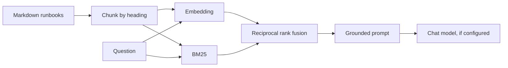

# Runbook Copilot

A console app that answers questions about a fictional operations guide. Search works with no API key. A chat model is optional and plugs in later.

The company in the runbooks is Northwind Cloud. It is invented. The shape of the work (tenants, regions, failover, secrets) is familiar so the lessons transfer. None of the text comes from any employer's documents.

## Run

From this folder:

```powershell
dotnet test
dotnet run --project src/RunbookCopilot -- eval
dotnet run --project src/RunbookCopilot -- ask "Which region is paired with eastus for failover?"
dotnet run --project src/RunbookCopilot -- agent --scripted "Is billing-api healthy and where is failover documented?"
dotnet run --project src/RunbookCopilot -- extract "Create a trial tenant for Contoso in eastus, environment dev, ending on 2026-11-01"
dotnet run --project src/RunbookCopilot -- trace ask "Which region is paired with eastus for failover?"
dotnet run --project src/RunbookCopilot -- trace agent "Is billing-api healthy and where is failover documented?"
```

`eval` prints recall@3. On the current runbooks that score is 8/8. It checks that the right file appears in the top 3 passages. It does not check the wording of a generated answer.

`ask` always prints the passages. With no model configured, it stops there. Those passages are the only text a model would be allowed to see.

`agent --scripted` walks a real tool loop. The stand-in model does not understand English. The console says so. It calls `get_service_status` and `search_runbooks`, then repeats what the tools returned.

`extract` without a model uses a regular expression, then the same validator a model response must pass. Unknown regions are rejected.

`trace` sends nothing. It prints the JSON body that would be posted: for `ask`, one request; for `agent`, one per turn of the loop. It calls `ChatRequest.Build`, the same method `OpenAiChatClient` posts, so the trace cannot drift from the real request. [Note 8](../../notes/08-the-request-body.md) reads the output line by line.

## Where a real model goes

Environment variables override `content/appsettings.json`. Do not put a key in the file.

Ollama, after `ollama pull llama3.2`:

```powershell
$env:COPILOT_PROVIDER = "OpenAICompatible"
$env:COPILOT_ENDPOINT = "http://localhost:11434/v1"
$env:COPILOT_CHAT_MODEL = "llama3.2"
```

Azure OpenAI:

```powershell
$env:COPILOT_PROVIDER = "AzureOpenAI"
$env:COPILOT_ENDPOINT = "https://YOUR-RESOURCE.openai.azure.com"
$env:COPILOT_API_KEY = "<your key>"
$env:COPILOT_CHAT_MODEL = "<deployment name>"
```

Leave `COPILOT_EMBEDDING_MODEL` empty until you want remote embeddings. Empty means the local hashing embedder stays in place, so `eval` remains comparable.

`ask` works with any chat model. `agent` needs a model that returns tool calls. If a local model ignores tools, keep using `--scripted` for the loop and use the real model for `ask`.

## What happens on a question



## Code map

| File | Job | Interview name |
| --- | --- | --- |
| `content/runbooks` | The private documents | corpus |
| `Chunking.cs` | Split on headings, window long sections | text splitter |
| `Embeddings.cs` | Turn text into a vector | embedding model |
| `Search.cs` | Keyword rank, vector rank, fuse the ranks | hybrid retriever |
| `GroundedPrompt.cs` | Build the prompt and forbid following the passages | prompt template |
| `Chat.cs` | HTTP to an OpenAI-compatible or Azure endpoint | LLM client |
| `ChatRequest` in `Chat.cs` | Build the JSON body that goes on the wire | the request itself |
| `Agent.cs` | Tools and the step loop | agent executor |
| `Extraction.cs` | JSON in, allowlist check | structured output |
| `Evaluation.cs` | recall@3, plus a rubric for later answers | eval |

## A result you should be able to explain

For "Which region is paired with eastus for failover?" the top passage is `failover.md`. A later passage can still be `incidents.md`. Common words such as "for" show up everywhere, and the hashing embedder is a coarse signal. Recall@3 stays perfect because the right file is present. A generated answer still has to ignore the distractor. That is why `ask` prints the passages beside the answer, and why the prompt says to use only those passages and to say "I do not know" when they are insufficient.

## Labs

[LABS.md](LABS.md) is the work that turns this from a folder you were given into an app you can defend.
